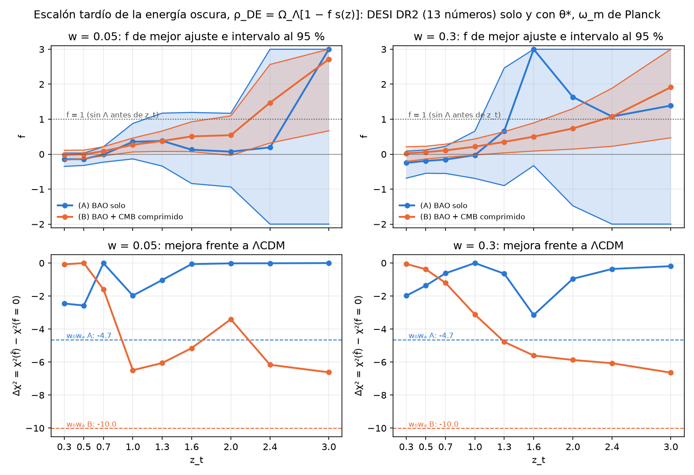

# ¿Cuánto de tarde puede encenderse la energía oscura? Barrido de un escalón determinista (exploración)

**Predicción, escrita antes de correr `escalon.py`:**
- (A) BAO solo: f = 1 excluido al 95 % para z_t ≤ 1.3 y no excluido para z_t ≥ 2.4; mejor Δχ² del barrido
  > −6 y p global > 0.1.
- (B) BAO + CMB comprimido: f = 1 excluido para z_t ≤ 1.0 (H0 sube demasiado); aparece una preferencia por
  f > 0 con z_t entre 1.5 y 2.5, Δχ² entre −6 y −12 y H0 entre 68.5 y 70, a menos de 3 unidades de Δχ² del
  ajuste w₀wₐ con los mismos datos.

Exploración: no cambia `results/`, `figures/` ni ningún paper. Script `escalon.py`; salidas
`escalon.{json,txt,png}` y `escalon_universos.npz` (mejor Δχ² y mejor f por celda de cada universo, en (A) y
en (B)). Tiempo: 4 min con 16 procesos.

## Montaje

**Modelo.** ρ_DE(z)/ρ_crit,0 = Ω_Λ·[1 − f·s(z)], s(z) = ½[1 + tanh((ln(1+z) − ln(1+z_t))/w)], s → 1 en el
pasado: f = 1 es energía oscura ausente antes de z_t, f = 2 un cambio de signo, f = 0 ΛCDM. Plano: Ω_Λ queda
fijada por la planitud de hoy, Ω_Λ·[1 − f·s(0)] = 1 − Ω_m (− Ω_r en (B)), así que la forma que entra en H²
es g(z) = [1 − f·s(z)]/[1 − f·s(0)]. Con w = 0.05, s(0) < 4 × 10⁻⁵ y da igual; con w = 0.3 y z_t = 0.3,
s(0) = 0.15, y es una elección que hay que decir. Distancias exactas: Simpson en mallas fijas (la de
`cuesta.py` hasta z = 2.33 y 4001 puntos en ln(1+z) hasta z_*), comprobadas frente a `quad` a 4 × 10⁻¹⁰ en los
13 números y 3 × 10⁻¹¹ en D_M(z_*). H² > 0 se comprueba en todos los puntos de la malla; una violación da
χ² = ∞. En la práctica no actuó en ningún perfil: a Ω_m (o h, ω_m) fijos, f ≳ 1.5–3 con z_t ≤ 0.7 da H² < 0
cerca de z_t, pero el perfil sube Ω_m y H² se mantiene positivo en el mínimo; ningún intervalo toca ese muro.

**Malla:** z_t ∈ {0.3, 0.5, 0.7, 1.0, 1.3, 1.6, 2.0, 2.4, 3.0} × w ∈ {0.05, 0.3}; perfil de χ² en f ∈ [−2, 3]
con paso 0.05 y refinamiento acotado alrededor del mínimo. Convenio: **Δχ² = χ²(f̂) − χ²(f = 0) ≤ 0**, también
para w₀wₐ (en `CUESTA.md` el mismo número lleva el signo contrario). Intervalo al 95 %: Δχ² = 3.84 desde el
mínimo, el tramo conexo alrededor de f̂, con los cruces por `brentq` sobre el perfil reajustado; "b" marca que
el intervalo llega al borde −2 o 3 de la malla. "f = 1 excluido" quiere decir χ²(f = 1) − χ²(f̂) > 3.84.

**(A) BAO solo:** los 13 números de DESI DR2 con la covarianza oficial, Ω_m y h·r_d libres (h·r_d analítico,
Ω_m por Brent acotado), sin radiación, como `cuesta.py`. A f = 0 se recupera χ² = 10.271, Ω_m = 0.2975,
h·r_d = 101.54 Mpc en las 18 celdas. w₀wₐ: `cuesta.fit_both` (mismos priores de DESI), Δχ² = −4.65.

**(B) BAO + CMB comprimido:** parámetros (h, ω_m, f).
- r_d(ω_m) y r_s(z_*; ω_m): integral sin energía oscura de `everpresent/rdcalc.py` (ω_b = 0.02237, z_d
  escalado con Eisenstein–Hu, normalización a CAMB en Planck como en `rd_planck.json`); z_* escalado con ω_m
  por Hu–Sugiyama (la función de `theta_star.py`). En Planck: r_d = 147.103 Mpc (CAMB 147.103), r_s(z_*) =
  144.444 (CAMB 144.443, 9 × 10⁻⁶); pendiente d ln r_d/d ln ω_m = −0.257 (Aubourg: −0.255).
- D_M(z_*) con la historia modificada, radiación incluida (ω_r = 4.18 × 10⁻⁵ de `rd_planck.json`, los
  neutrinos masivos como materia, como en la comprobación analítica de `rd_planck.py`).
- 100θ_* = 100 r_s(z_*)/D_M(z_*), **calibrado**: la historia ΛCDM de Planck por este código da 1.04149 frente
  a 1.04120 de CAMB (+0.94σ de Planck, el mismo sesgo que registra `theta_star.py` en su validación 1, que
  viene del tratamiento de los neutrinos en D_M), y se divide por ese cociente 1.000278 (la variante
  "calibrated" de `theta_star.py`). Sin calibrar, el χ² de (B) cargaría un sesgo fijo de 0.9σ en θ_*.
- χ² = χ²_BAO + [(100θ_* − 1.04110)/0.00031]² + [(ω_m − 0.14301)/0.0011]². θ_* y su error son los de
  `theta_star.py` (Planck 2018 VI, Tabla 2, TT,TE,EE+lowE+lensing); ω_m = 0.14301 es el `omega_m_incl_nu` de
  `rd_planck.json` (ω_b + ω_c + ω_ν de `ou_cmb.PLANCK18`). **El error de ω_m no está en esos archivos:**
  es Ω_m h² = 0.1430 ± 0.0011 de la misma Tabla 2 (arXiv:1807.06209), comprobado en el artículo.
- (h, ω_m) por mínimos cuadrados (trf, cotas h ∈ [0.4, 1], ω_m ∈ [0.05, 0.3]) sobre los residuos blanqueados.
- w₀wₐ con las mismas condiciones: (h, ω_m, w₀, wₐ), seis arranques, priores de DESI w₀ ∈ [−3, 1],
  wₐ ∈ [−3, 2], w₀ + wₐ < 0.

**ΛCDM en (B):** H0 = 68.19, ω_m = 0.14072, Ω_m = 0.3026, χ² = 17.24 = 12.64 (BAO) + 0.23 (θ_*) + 4.37 (ω_m).
Es decir: añadir el CMB comprimido a los 13 números cuesta **6.97 unidades** de χ² a ΛCDM, casi todas en ω_m
(el ajuste se queda 2.1σ por debajo del ω_m de Planck). De memoria, no comprobado aquí: DESI DR2 + CMB
completo en ΛCDM da H0 ≈ 68.2, así que el comprimido reproduce bien el fondo.

**w₀wₐ en (B):** Δχ² = **−10.02**, H0 = 63.7, Ω_m = 0.352, w₀ = −0.44, wₐ = −1.68. Con el CMB completo DESI
cita −12.5 (`CUESTA.md`); el comprimido recoge 10 de esos 12.5.

**Efecto de mirar en muchos sitios.** 2000 universos ΛCDM de solo ruido: los mismos 2000 vectores de ruido de
`cuesta.py` (semilla 20261105, covarianza oficial) sumados a la predicción del mejor ajuste ΛCDM de cada
tratamiento ((A): Ω_m = 0.2975, h·r_d = 101.54; (B): H0 = 68.19, ω_m = 0.1407). En (B) los dos números del
CMB también se perturban: θ_*^obs = θ_*(verdad) + 0.00031·ξ₁, ω_m^obs = 0.1407 + 0.0011·ξ₂ (semilla 20261111);
si no, los universos tendrían el CMB clavado en la verdad y la distribución saldría demasiado estrecha. A cada
universo se le hace el mismo barrido (malla gruesa en f, paso 0.25, más refinamiento acotado; con los datos
reales la malla gruesa y la fina dan el mismo mejor Δχ² a 10⁻³) y se guarda el mejor Δχ² sobre (z_t, w, f).
p global = fracción de universos con un mejor Δχ² al menos tan negativo como el observado.

## Resultados

**(A) BAO solo** (χ²(ΛCDM) = 10.27; w₀wₐ: Δχ² = −4.65):

| z_t | w | f̂ | Δχ² | f al 95 % | Δχ²(f = 1) | f = 1 excluido | Ω_m | h·r_d |
|---|---|---|---|---|---|---|---|---|
| 0.3 | 0.05 | −0.15 | −2.45 | [−0.35, +0.04] | +282.7 | **sí** | 0.302 | 99.7 |
| 0.5 | 0.05 | −0.14 | −2.57 | [−0.32, +0.03] | +163.5 | **sí** | 0.294 | 100.9 |
| 0.7 | 0.05 | −0.01 | −0.01 | [−0.23, +0.21] | +66.4 | **sí** | 0.297 | 101.5 |
| 1.0 | 0.05 | +0.35 | −1.97 | [−0.14, +0.88] | +3.73 | **sí** (justo: 5.7 > 3.84) | 0.313 | 100.9 |
| 1.3 | 0.05 | +0.38 | −1.03 | [−0.34, +1.17] | +1.37 | no (2.4) | 0.309 | 100.9 |
| 1.6 | 0.05 | +0.13 | −0.06 | [−0.84, +1.19] | +2.56 | no (2.6) | 0.300 | 101.4 |
| 2.0 | 0.05 | +0.07 | −0.02 | [−0.94, +1.17] | +2.78 | no (2.8) | 0.299 | 101.5 |
| 2.4 | 0.05 | +0.20 | −0.01 | [−2, 3] b | +0.19 | no | 0.298 | 101.5 |
| 3.0 | 0.05 | (plano) | −0.00 | [−2, 3] b | −0.00 | no | 0.2975 | 101.5 |
| 0.3 | 0.3 | −0.25 | −1.98 | [−0.69, +0.09] | +119.1 | **sí** | 0.304 | 99.2 |
| 0.5 | 0.3 | −0.19 | −1.37 | [−0.55, +0.12] | +74.4 | **sí** | 0.2975 | 100.3 |
| 0.7 | 0.3 | −0.15 | −0.63 | [−0.55, +0.22] | +38.1 | **sí** | 0.295 | 101.0 |
| 1.0 | 0.3 | −0.03 | −0.01 | [−0.69, +0.66] | +8.46 | **sí** | 0.297 | 101.5 |
| 1.3 | 0.3 | +0.67 | −0.65 | [−0.90, +2.46] | −0.50 | no (0.15) | 0.315 | 101.3 |
| 1.6 | 0.3 | +3.00 b | **−3.15** | [−0.33, 3] b | −1.62 | no (1.5) | 0.357 | 99.7 |
| 2.0 | 0.3 | +1.64 | −0.96 | [−1.48, 3] b | −0.82 | no | 0.321 | 100.5 |
| 2.4 | 0.3 | +1.08 | −0.36 | [−2, 3] b | −0.36 | no | 0.308 | 101.0 |
| 3.0 | 0.3 | +1.39 | −0.19 | [−2, 3] b | −0.18 | no | 0.304 | 101.2 |

(Entre paréntesis en "no": χ²(f = 1) − χ²(f̂), lo que le falta para 3.84. Con z_t = 3 y w = 0.05 el escalón
está fuera del alcance de DESI, s(2.33) < 10⁻³, y el perfil es plano a 10⁻³.)

- **f = 1 (sin Λ antes de z_t) está excluido para z_t ≤ 1.0 con los dos anchos**, y deja de estarlo en
  z_t = 1.3 (en w = 0.05 le faltan 1.4 unidades; en w = 0.3 es casi el mejor ajuste). Entre z_t = 1.3 y 2.0 el
  intervalo contiene f = 1 pero excluye f = 2 (w = 0.05); desde z_t = 2.4 no hay cota.
- A z_t ≤ 0.5 los datos prefieren f ligeramente negativo (algo más de energía oscura en el pasado,
  Δχ² ≈ −2.5), y a z_t ≈ 1–1.6 ligeramente positivo: es la misma forma que ve w₀wₐ (menos Λ a z ≈ 1–2 con
  más Ω_m), vista por un parámetro. El mejor del barrido, −3.15 en (z_t, w) = (1.6, 0.3) con f en el borde 3 y
  Ω_m = 0.357, recoge dos tercios del −4.65 de w₀wₐ con un parámetro menos.

**(B) BAO + CMB comprimido** (χ²(ΛCDM) = 17.24; w₀wₐ: Δχ² = −10.02 con H0 = 63.7):

| z_t | w | f̂ | Δχ² | f al 95 % | Δχ²(f = 1) | f = 1 excluido | H0 | Ω_m |
|---|---|---|---|---|---|---|---|---|
| 0.3 | 0.05 | −0.02 | −0.08 | [−0.17, +0.11] | +1188 | **sí** | 67.95 | 0.305 |
| 0.5 | 0.05 | −0.00 | −0.00 | [−0.13, +0.12] | +651 | **sí** | 68.18 | 0.303 |
| 0.7 | 0.05 | +0.09 | −1.59 | [−0.05, +0.21] | +313 | **sí** | 68.63 | 0.300 |
| 1.0 | 0.05 | +0.27 | **−6.49** | [+0.06, +0.46] | +57.4 | **sí** | 68.88 | 0.300 |
| 1.3 | 0.05 | +0.38 | −6.05 | [+0.08, +0.66] | +13.3 | **sí** | 68.76 | 0.301 |
| 1.6 | 0.05 | +0.51 | −5.15 | [+0.07, +0.93] | +0.19 | **sí** (5.3) | 68.67 | 0.302 |
| 2.0 | 0.05 | +0.54 | −3.41 | [−0.03, +1.10] | −0.80 | no (2.6) | 68.51 | 0.302 |
| 2.4 | 0.05 | +1.47 | −6.16 | [+0.32, +2.57] | −5.50 | no (0.7) | 68.76 | 0.302 |
| 3.0 | 0.05 | +2.72 | −6.62 | [+0.67, 3] b | −3.90 | no (2.7) | 68.80 | 0.302 |
| 0.3 | 0.3 | +0.03 | −0.06 | [−0.21, +0.21] | +421 | **sí** | 68.45 | 0.301 |
| 0.5 | 0.3 | +0.06 | −0.38 | [−0.14, +0.23] | +274 | **sí** | 68.67 | 0.299 |
| 0.7 | 0.3 | +0.11 | −1.20 | [−0.09, +0.29] | +158 | **sí** | 68.86 | 0.298 |
| 1.0 | 0.3 | +0.22 | −3.12 | [−0.03, +0.44] | +56.7 | **sí** | 69.03 | 0.298 |
| 1.3 | 0.3 | +0.35 | −4.78 | [+0.04, +0.64] | +15.5 | **sí** | 69.06 | 0.298 |
| 1.6 | 0.3 | +0.50 | −5.61 | [+0.09, +0.89] | +0.71 | **sí** (6.3) | 69.00 | 0.299 |
| 2.0 | 0.3 | +0.74 | −5.87 | [+0.14, +1.30] | −5.05 | no (0.8) | 68.91 | 0.300 |
| 2.4 | 0.3 | +1.07 | −6.07 | [+0.23, +1.89] | −6.04 | no (0.03) | 68.86 | 0.301 |
| 3.0 | 0.3 | +1.91 | **−6.64** | [+0.47, 3] b | −5.08 | no (1.6) | 68.87 | 0.301 |

- **f = 1 está excluido hasta z_t = 1.6 con los dos anchos** (más lejos que en BAO solo, donde la cota acaba
  en 1.0) y deja de estarlo en z_t = 2.0. A z_t = 2.4 el mejor ajuste es f ≈ 1.1–1.5 y a z_t = 3, f ≈ 1.9–2.7:
  **un cambio de signo de Λ a z ≈ 2.4–3 (f = 2) está dentro del intervalo al 95 % en (B)**, con el intervalo
  tocando el borde f = 3 en z_t = 3.
- **Desde z_t = 1.0 aparece f > 0 a Δχ² ≈ −5 a −6.6 con H0 = 68.5–69.1**, y f = 0 queda fuera del 95 % en
  10 de las 18 celdas (z_t ≥ 1.0 con w = 0.05, z_t ≥ 1.3 con w = 0.3; en z_t = 2.0, w = 0.05 lo roza). La mejora
  es casi constante en z_t: el escalón hace lo mismo en todas partes, quitar energía oscura por encima de z_t
  para alargar D_M(z_*) a h fija. El tope es 6.97 (lo que cuesta añadir el CMB a ΛCDM), y el escalón se queda
  en −6.6: con z_t = 3 el único dato que ve el escalón es θ_*, y un parámetro libre en θ_* devuelve el ajuste
  a BAO solo (χ²_BAO → 10.3, ω_m → 0.1428, H0 → 68.8).
- **Mecanismo.** BAO solo fija Ω_m = 0.2975 y h·r_d = 101.54. Con ω_m = 0.1430 de Planck, r_d = 147.1 y
  h = 0.690, Ω_m = 0.300: coherente con los BAO. Pero θ_* en ΛCDM a h = 0.69 sale demasiado grande, y ΛCDM
  negocia a H0 = 68.19 bajando ω_m 2.1σ. Quitar energía oscura por encima de z ≈ 1 (f > 0) baja H(z) ahí,
  alarga D_M(z_*) y devuelve θ_* a Planck con h = 0.69 y ω_m = 0.143. No es "H0 sube demasiado" lo que excluye
  f = 1 a z_t bajo: lo excluyen los propios BAO (en (A) ya es +283 a z_t = 0.3); el CMB solo añade el H0.
- Las celdas se parecen porque el escalón a z_t ≥ 1 es casi invisible para los BAO (en (A), Δχ² entre 0 y −2) y
  todo el Δχ² viene del CMB comprimido. Es un dato efectivo (D_M(z_*)) contra un parámetro: cualquier z_t
  por encima de ~1 sirve.

**Efecto de mirar en muchos sitios (2000 universos de solo ruido):**

| | observado (mejor del barrido) | p global | mejor Δχ² de ruido: p5 / p50 / p95 | P(mejor ≤ −6) | P(mejor ≤ −3.84) |
|---|---|---|---|---|---|
| (A) | −3.15 (z_t = 1.6, w = 0.3) | **0.26 ± 0.01** | −6.40 / −1.85 / −0.32 | 6.1 % | 19 % |
| (B) | −6.64 (z_t = 3, w = 0.3) | **0.047 ± 0.005** | −6.46 / −1.91 / −0.42 | 6.3 % | 19 % |

- La mediana del mejor Δχ² de solo ruido es −1.9 en los dos tratamientos, frente a −0.45 en una celda sola:
  barrer 18 celdas (que no son independientes: las de un mismo w se parecen) cuadruplica la mejora típica de
  un parámetro. Un Δχ² = −6 lo produce el ruido el 6 % de las veces.
- (A): el −3.15 observado es ordinario (p = 0.26). Los p locales de las celdas más negativas: 0.11 (z_t = 0.3,
  w = 0.05), 0.065 (z_t = 1.6, w = 0.3).
- (B): p global 0.047. Los p locales son 0.009–0.025 en todas las celdas con z_t ≥ 1.0 (w = 0.05, salvo
  z_t = 2.0, 0.069) o ≥ 1.3 (w = 0.3), es decir, ~2.3σ locales que el barrido deja en ~2σ global. En los universos de ruido, la celda que
  gana es z_t = 3 (18 %), 2.0 (16 %) o 0.3 (15 %), w = 0.05; las de w = 0.3 ganan poco (6 % entre las nueve)
  porque su escalón es más suave y su f menos eficaz por unidad.
- Lo que mide este p: con cuánta frecuencia DESI + (θ_*, ω_m) sin tensión produce, por azar, una mejora
  ≤ −6.64 en algún escalón. No incluye que la elección "un escalón" se hizo sabiendo que hay tensión.

## Predicción

- **(A) f = 1 excluido para z_t ≤ 1.3: no se cumplió del todo.** Excluido hasta z_t = 1.0; en 1.3 le faltan
  1.4 unidades (w = 0.05) y en w = 0.3 f = 1 es prácticamente el mejor ajuste. No excluido para z_t ≥ 2.4:
  cumplida. Mejor Δχ² > −6 (−3.15) y p global > 0.1 (0.26): **cumplidas.**
- **(B) f = 1 excluido para z_t ≤ 1.0: cumplida,** y más: hasta 1.6. El motivo que di (H0 sube demasiado) era
  el equivocado: a z_t ≤ 1 lo excluyen los BAO; el CMB solo afina. **Preferencia por f > 0 con z_t entre 1.5 y
  2.5: cumplida en parte.** Aparece desde z_t = 1.0 y sigue hasta 3.0, no en una ventana. **Δχ² entre −6 y
  −12: en el borde** (−6.0 a −6.6 en seis celdas, el resto entre −3 y −6). **H0 entre 68.5 y 70: cumplida**
  (68.5–69.1). **A menos de 3 unidades del w₀wₐ con los mismos datos: no se cumplió, por poco:** 3.4
  (−6.64 frente a −10.02).

**¿Absorben el escalón y la cuesta la misma diferencia entre DESI y Planck?** No. El escalón absorbe solo la
diferencia Planck–DESI en ΛCDM (los 7 de χ² que cuesta θ_* y ω_m: se lleva 6.6 y en BAO solo no gana casi
nada), y lo hace **subiendo** H0 a 68.9 con Ω_m = 0.30; la cuesta w₀wₐ gana 4.65 en los propios BAO (la forma
a z < 1 que un escalón no reproduce), otros 5.4 al añadir el CMB, y lo hace **bajando** H0 a 63.7 con
Ω_m = 0.35, por la degeneración w₀–wₐ–H0. Son dos lecturas distintas de la misma tensión: menos Λ en el
pasado y un D_M(z_*) más largo a H0 alto (escalón) frente a una Λ que decrece hoy con H0 bajo (cuesta); los
datos comprimidos no eligen entre ellas con claridad (3.4 unidades a favor de la cuesta, con un parámetro más).

## Relación con modelos publicados (identificadores comprobados en arXiv)

- **PEDE**, Li & Shafieloo 2019, arXiv:1906.08275: Ω_DE(z) = Ω_DE,0·[1 − tanh(log₁₀(1+z))], sin parámetros
  libres. En nuestra parametrización es f = 1, z_t = 0 y w = ln 10 ≈ 2.3 (Ω_Λ fijada por planitud): un
  escalón muy ancho centrado hoy, fuera de nuestra malla (w ≤ 0.3, z_t ≥ 0.3). La tabla (A) ya dice que
  f = 1 con z_t ≤ 1 queda excluido con cualquiera de nuestros anchos; PEDE necesita el ancho para sobrevivir.
- **Λ con cambio de signo:** Akarsu, Barrow, Escamilla & Vázquez 2019, arXiv:1912.08751 (energía oscura
  "graduada", que señala un cambio de signo de ρ_DE en z ≈ 2.32) y Akarsu, Kumar, Özülker & Vázquez 2021,
  arXiv:2108.09239 (ΛsCDM: Λ cambia de signo en z_†; con CMB + BAO, z_† = 2.44 ± 0.29). Es f = 2 con w → 0.
  Aquí, en (B), f = 2 está dentro del 95 % para z_t = 2.4 ([0.32, 2.57]) y 3.0 ([0.67, 3]), con H0 ≈ 68.8–68.9
  y Δχ² ≈ −6: el mismo lugar y el mismo signo que ellos, pero con θ_* y ω_m solos; su H0 ≈ 74.5 para
  z_† = 1.5 no sale de estos datos, y a z_t = 1.6 nuestro f = 2 está excluido ([0.07, 0.93]).
- **Metamorfosis del vacío**, Di Valentino, Linder & Melchiorri 2017, arXiv:1710.02153: transición de fase
  del vacío (Parker), que quita la tensión en H0 con Δχ² hasta −7.5. No es un escalón en ρ_DE sino un cambio
  de la ecuación de estado a z bajo; su mejora frente a ΛCDM es del mismo tamaño que la nuestra, y como en
  los otros dos, la parte que les sube H0 viene de datos locales que aquí no entran.

Los cuatro identificadores cuadraban con lo recordado; no hubo que corregir ninguno.
