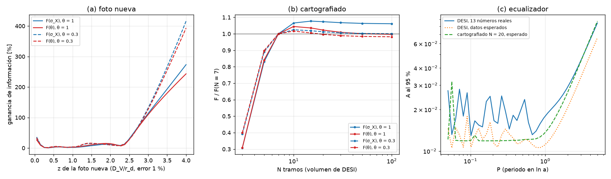

# Dónde poner la próxima foto: diseño por Fisher (exploración)

**Predicción, escrita antes de correr `fisher_diseno.py`:**
- F(σ_X) casi plana en N (±20 %).
- F(θ) crece hasta N ≈ 10–20 y satura.
- La foto nueva más valiosa está a z > 2.
- Ecualizador: cota más estrecha en P ≈ 0.3–1, sin cota en P ≫ 1 al marginalizar, y degradada por debajo
  de P ≈ 0.14.

Exploración: no cambia `results/`, `figures/` ni ningún paper. Script `fisher_diseno.py`; salidas
`fisher_diseno.{json,txt,png}`.

## Montaje

- **Datos y modelo, como en `perfil_13.py`:** filas (z, tipo) en unidades de α referidas al mejor ajuste
  ΛCDM de DESI DR2 (Ω_m = 0.29740, h·r_d = 101.538 Mpc); covariancia oficial 13 × 13 reescalada; residuo
  δα_i = S_i X(z_i) con S por tipo; núcleo K_ij = S_iS_j σ_X² e^{−θ|Δx|}, x = ln(1+z).
- **Fondo marginalizado por proyección:** con las plantillas lineales T = [∂α/∂Ω_m, α] en la referencia, la
  verosimilitud marginal (prior plano) tiene precisión W = Σ⁻¹ − Σ⁻¹T(TᵀΣ⁻¹T)⁻¹TᵀΣ⁻¹, Σ = C + K, y la
  matriz de Fisher de (σ_X, θ) es F_ab = ½ tr(W ∂_aΣ W ∂_bΣ), evaluada en σ_X = 1.5 × 10⁻² y θ = 1 y 0.3.
- **F(σ_X) y F(θ) son las informaciones marginales** 1/(F⁻¹)_aa (el otro parámetro marginalizado). Las
  condicionales (diagonal de F) se guardan también y se citan cuando cambian la lectura.
- **(a)** una D_V/r_d nueva con error del 1 %, sin correlación, en 40 z de [0.05, 4]; ganancia relativa
  F_nueva/F_13 − 1.
- **(b)** volumen total de DESI en N tramos iguales en ln(1+z) entre z = 0.1 y 2.3; cada tramo da D_M/r_d y
  D_H/r_d con errores ε_M√(N/7) y ε_H√(N/7) y la correlación media D_M–D_H de DESI, donde ε_M = 1.36 % y
  ε_H = 1.92 % son las medias de los seis bins anisótropos de DESI (ρ = −0.42): N = 7 reproduce los errores
  medios de DESI. N ∈ {3, 5, 7, 10, 15, 20, 30, 50, 100}.
- **(c)** X = A sin(2π ln a/P + φ), ln a = −x; cota al 95 % sobre A en 40 P de [0.05, 5], φ marginalizada
  numéricamente (uniforme, 180 fases) y fondo marginalizado (W con Σ = C); cota = cruce superior de
  ΔlnL = −1.92 desde el máximo en A ∈ [0, 1], el convenio de `FONDO.md`. Tres casos: los 13 números reales
  de DESI, los datos esperados de DESI (α = 1) y los datos esperados del cartografiado con N = 20.

**Punto de partida, DESI 13 números en σ_X = 1.5 × 10⁻²:**

| θ | σ(σ_X) condicional | σ(θ) condicional | σ(σ_X) marginal | σ(θ) marginal | correlación σ_X–θ |
|---|---|---|---|---|---|
| 1 | 0.0129 | 2.0 | 0.090 | 14 | +0.990 |
| 0.3 | 0.0233 | 0.99 | 0.57 | 24 | +0.999 |

Con σ_X al nivel de la cota, DESI no resuelve θ (σ(θ) ≫ θ) y σ_X y θ están casi completamente degenerados:
es el resultado de `RESOLVER_THETA.md` visto desde Fisher. Por eso las ganancias marginales de abajo son
grandes en porcentaje: parten de casi nada.

## Resultados

**(a) Foto nueva (ganancia de información marginal, en %):**

| θ | z = 0.05 | mínimo | z = 2 | z = 2.3 | z = 3 | z = 4 (óptimo) |
|---|---|---|---|---|---|---|
| 1 | +32 | +0.5 (z = 0.35) | +12 (σ_X), +14 (θ) | +9 | +114 | **+273 (σ_X), +243 (θ)** |
| 0.3 | +36 | +1.5 (z = 0.35) | +10, +10 | +10 | +132 | **+416 (σ_X), +393 (θ)** |

- El óptimo está en el borde de la malla, z = 4, para los dos parámetros y los dos θ. La curva es plana
  (≤ 15 %) dentro del rango de DESI, 0.3 < z < 2.3, sube con fuerza por encima de z ≈ 2.5 y tiene un
  repunte modesto en z → 0 (+30 %).
- Las ganancias condicionales son más pequeñas (máximo +58 % en σ_X y +45 % en θ con θ = 1, +75 y +67 % con
  θ = 0.3), con la misma forma y el mismo óptimo.

**(b) Cartografiado (F/F(N = 7), marginal):**

| θ | N = 3 | 5 | 7 | 10 | 15 | 20 | 30 | 50 | 100 | N_90(θ) |
|---|---|---|---|---|---|---|---|---|---|---|
| 1, F(σ_X) | 0.31 | 0.83 | 1 | 1.07 | 1.08 | 1.07 | 1.07 | 1.06 | 1.06 | — |
| 1, F(θ) | 0.31 | 0.84 | 1 | **1.04** | 1.04 | 1.02 | 1.01 | 1.00 | 1.00 | **7** |
| 0.3, F(σ_X) | 0.39 | 0.89 | 1 | 1.02 | 1.02 | 1.01 | 1.01 | 1.00 | 1.00 | — |
| 0.3, F(θ) | 0.40 | 0.90 | 1 | **1.02** | 1.01 | 1.00 | 0.99 | 0.98 | 0.98 | **7** |
| extra: 3, F(θ) | 0.14 | 0.70 | 1 | 1.15 | **1.17** | 1.15 | 1.11 | 1.09 | 1.07 | 10 |
| extra: 10, F(θ) | 0.01 | 0.31 | 1 | 1.89 | 2.55 | **2.70** | 2.63 | 2.47 | 2.35 | 15 |

- Con θ = 1 y 0.3, F(θ) alcanza el 90 % de su máximo ya en N = 7, toca el máximo en N = 10 (+2–4 %) y baja
  despacio. F(σ_X) sube un 7 % (θ = 1) o un 2 % (θ = 0.3) y se queda. Lo único que cuesta caro es N = 3
  (−60 a −70 %) y, algo, N = 5 (−10 a −17 %).
- Las dos filas extra (θ = 3 y 10, no pedidas) muestran dónde empieza a pagar la resolución: con θ = 10,
  F(θ) se multiplica por 2.7 en N = 20 (N_90 = 15).

**(c) Ecualizador (cota al 95 % sobre A):**

| caso | P ≤ 1: mínimo, mediana, máximo | P = 2 | P = 5 | A_95(5)/A_95(2) |
|---|---|---|---|---|
| DESI, 13 números reales | 0.0129 (P = 0.10), 0.0169, 0.0280 | 0.029 | 0.085 | 2.9 |
| DESI, datos esperados | 0.0105 (P = 0.056), 0.0122, 0.0178 | 0.021 | 0.066 | 3.2 |
| cartografiado N = 20, esperado | 0.0119 (P = 0.16), 0.0120, 0.0319 (P = 0.056) | 0.027 | 0.087 | 3.3 |

- Ninguna curva queda sin cota hasta P = 5: por encima de P ≈ 1 la cota crece como A_95 ∝ P (factor
  3 entre P = 2 y 5, que es un factor 2.5 en P).
- Por debajo de P ≈ 1 la cota es plana en su envolvente (0.011–0.013) y, con DESI, oscila entre 0.013 y
  0.028 según P. El cartografiado regular tiene una cota perfectamente plana (0.0119) salvo un pico en
  P = 0.056 (0.032).

## Por qué

1. **La foto más valiosa está donde no hay fotos: z > 2.5.** La información sobre (σ_X, θ) está en cómo se
   descorrelaciona el residuo entre puntos; con el fondo marginalizado, lo que resta es el residuo
   ortogonal a (Ω_m, h·r_d), y un punto a x = ln 5 = 1.61, lejos del último de DESI (x = 1.20), añade la
   palanca más larga. Dentro del rango de DESI una foto más no cambia nada (≤ 15 %): los tramos ya se
   solapan en correlación (θ = 1 correlaciona a Δx ~ 1, y DESI cubre Δx = 0.94). El repunte en z → 0 es la
   otra palanca, más corta.
2. **F(σ_X) y F(θ) son planas en N porque el error ∝ √N conserva la información total** de cualquier señal
   suave en el tramo: repartir el mismo volumen en más tramos solo ayuda a resolver estructura más fina que
   el tramo, y un OU con θ = 1 o 0.3 (longitud de correlación Δx = 1–3) no tiene nada por debajo de
   Δx = 0.16, que es el tramo de N = 7. N = 3 pierde porque tres puntos no bastan para separar el residuo
   del fondo de dos parámetros. Solo con θ ≳ 3 empieza a pagar afinar, y con θ = 10 el óptimo está en
   N ≈ 20.
3. **El ecualizador no tiene máximo en P ≈ 0.3–1: tiene una meseta hasta P ≈ 1 y una subida ∝ P.** Para
   P ≫ 1, X ≈ A sin φ − A cos φ · 2πx/P: la constante se la lleva el fondo y lo que queda es una pendiente
   en x de amplitud 2πA/P, de ahí A_95 ∝ P. "Sin cota" solo en el límite P → ∞; en P = 5 la cota es 0.085,
   todavía dentro de A ≤ 1. Por debajo de P ≈ 1 un periodo cabe dentro del rango de DESI y la cota es la de
   un residuo cualquiera que el fondo no absorbe: ≈ 0.012, igual que la cota marginalizada con θ ≳ 10.
4. **Por debajo de P ≈ 0.14 no hay degradación sistemática sino aliasing según el muestreo.** Con los siete
   z irregulares de DESI, la cota oscila entre 0.013 y 0.028 para todo P < 1 (según qué fases pueden
   esconderse entre los puntos) y no empeora al bajar P; con el cartografiado regular, la cota se mantiene
   plana hasta P = 0.05 salvo el pico en P = 0.056, que es justo el espaciado Δx = 0.06 de los tramos: ahí
   todos los puntos ven la misma fase y el armónico es una constante que el fondo absorbe. El límite de
   Nyquist no aparece porque el residuo entra a través de S(z), que varía entre puntos y rompe la
   degeneración.

## Predicción

- **F(σ_X) casi plana en N (±20 %): cumplida para N ≥ 5** (0.83–1.08), no para N = 3 (0.31–0.39).
- **F(θ) crece hasta N ≈ 10–20 y satura: a medias.** El máximo está en N = 10, pero la subida desde N = 7
  es del 2–4 %; el 90 % se alcanza ya en N = 7. La saturación llega antes de lo previsto porque con θ ≤ 1
  no hay estructura por debajo del tramo. Lo previsto ocurre con θ = 10 (máximo en N = 20).
- **La foto más valiosa a z > 2: cumplida.** Óptimo en z = 4 (borde), +240 a +420 % marginal; dentro de
  2 < z < 2.5 la ganancia es solo del 9–14 %, y el salto empieza en z ≈ 2.5.
- **Ecualizador: cota más estrecha en P ≈ 0.3–1: no se cumplió** (meseta plana desde P = 0.05 hasta 1; el
  mínimo con DESI está en P = 0.10). **Sin cota en P ≫ 1 al marginalizar: no se cumplió dentro de P ≤ 5**
  (la cota crece ∝ P y vale 0.085 en P = 5). **Degradada por debajo de P ≈ 0.14: no se cumplió** (oscila,
  no se degrada; el único pico es el del espaciado del cartografiado regular).
